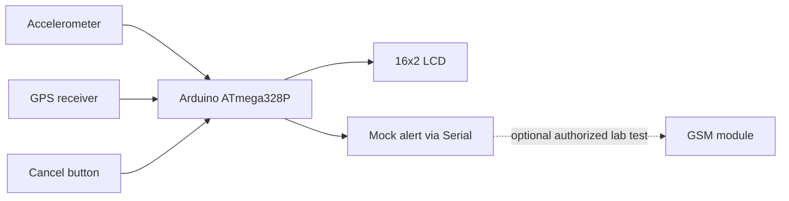

# Car Accident Alert System — Arduino + GPS/GSM Educational Demo

[](https://github.com/MamataDeshpande/car-accident-alert-system/actions/workflows/python-tests.yml)

**A new, independently written reconstruction of an undergraduate team electronics project.**

> **NOT AN EMERGENCY DEVICE.** This is an educational demonstration, not a tested or certified automotive safety system. It does not reliably detect road accidents, and it must never be relied upon to contact emergency services. Real SMS is **disabled by default**.

## Project overview

The original Car Accident Alert System project explored using an Arduino / ATmega328P with an ADXL335 accelerometer, GPS receiver, GSM modem and a 16×2 LCD to recognize a potential impact and communicate its location to a contact.

This new portfolio example recreates the engineering ideas while adding safe mock alerts, a countdown with cancellation, fresh GPS validation, and Python tests.

## Architecture



## Contents

| Path | Function |
|---|---|
| `arduino/CarAccidentAlert/CarAccidentAlert.ino` | Original Arduino demonstration sketch |
| `arduino/CarAccidentAlert/config.h` | Explicitly disabled SMS and illustrative lab values |
| `simulator/alert.py` | Hardware-free accelerometer, GPS/NMEA and mock alert example |
| `tests/test_alert.py` | 12 simulation unit tests |
| `examples/demo_trace.csv` | Artificial example measurement trace |
| `docs/HARDWARE_AND_SAFETY.md` | Electrical cautions and limitations |
| `.github/workflows/` | Python tests and Arduino build configurations |

## Run the Python simulator

Requires Python 3.10+. No external Python dependencies needed.

```bash
python -m unittest discover -s tests -v
python -m simulator.alert --csv outputs/demo_trace.csv
python -m simulator.alert --cancel --csv outputs/cancelled_trace.csv
```

All location values are fictional, and the mock message explicitly says no emergency service was notified.

## Arduino example

Open `arduino/CarAccidentAlert/CarAccidentAlert.ino` with Arduino IDE, select an Arduino Uno-compatible board and install the `TinyGPSPlus` library. See the [hardware and safety guide](docs/HARDWARE_AND_SAFETY.md) before wiring components. Arduino code has not been proven on actual vehicle hardware.

The demonstration uses analog accelerometer input, UART GPS parsing, LCD status messages and a manual cancel switch. The numerical sensor threshold is **illustrative, not calibrated for real collisions**. The optional GSM block must not be used to contact emergency services or third parties.

## Original research context

This is a **team undergraduate project**, not an individual original project. The historical university report described GPS/GSM accident alerts, an ATmega328P, ADXL335, LCD and Proteus simulations. This repository does **not** redistribute the team's old source code, full report, personal details or photographs.

See [Project Background](docs/PROJECT_BACKGROUND.md).

## Limitations

This is a mock educational prototype. No production fault handling, certified crash sensing, electrical safety validation, end-to-end network delivery, real GPS/GSM system test, or road deployment has been performed. Do not install this in an actual vehicle.

## License

The **new educational source code** is MIT-licensed. The original academic materials are not distributed or relicensed.
